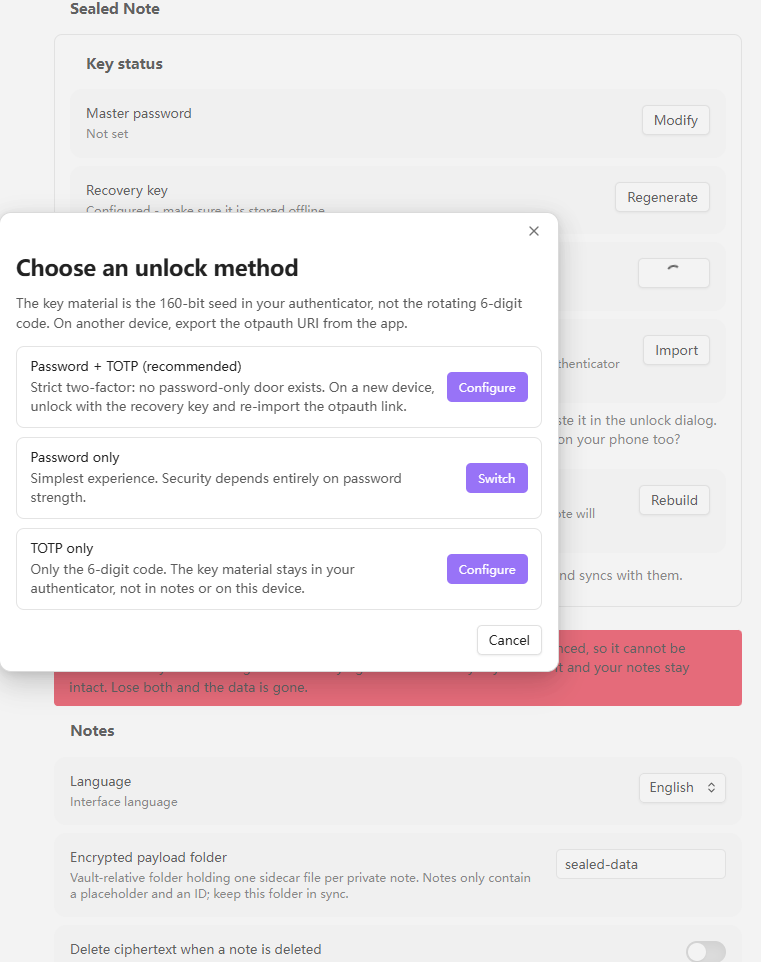
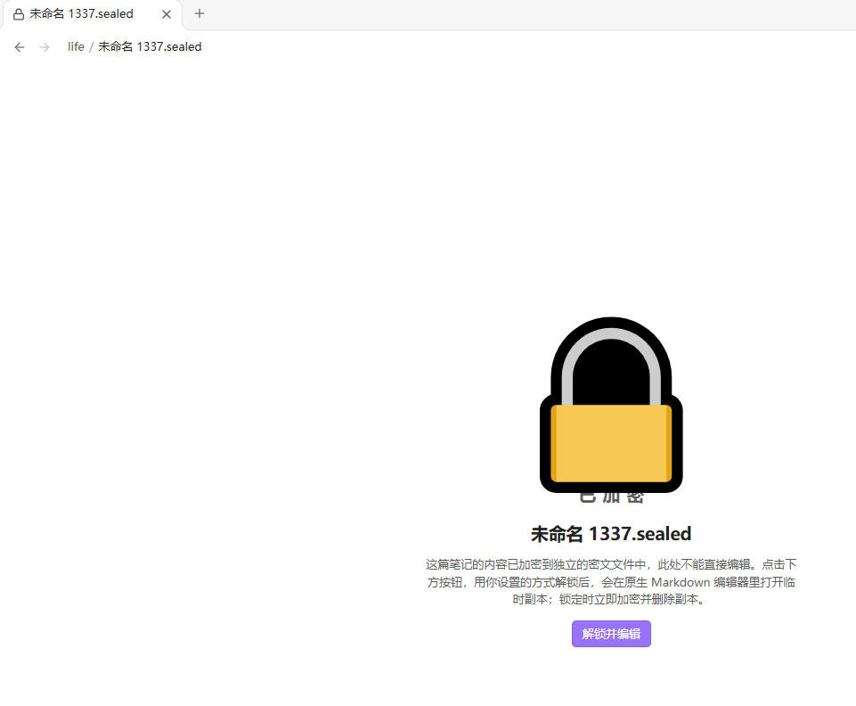

# Sealed Note

**English** | [简体中文](README.zh-CN.md)

An Obsidian plugin that encrypts **only the notes and fragments you choose** — not your whole vault. Losing your password never means permanently losing your data: a recovery key resets the password and rewraps the same data key without touching a single byte of your notes.

## Screenshots



*Settings page with the "Choose an unlock method" modal.*



*A private note in its locked state: the body is covered by a padlock until you unlock it.*

## Features

- **Only what you mark is encrypted** — full private notes (`.sealed.md`), inline blocks, and inline `sn1.…` fragments. The rest of the vault stays plain and searchable.
- **Password can be reset, never recovered** — anyone claiming to recover your password either deceives you or kept a backdoor. Here the recovery key rewraps the same data key; note content is never re-encrypted.
- **No keyring file** — the wrapped key lives in the `keys` field of every note's ciphertext payload, so it syncs with your notes and any one note can unlock the whole vault.
- **Native Markdown editing** — on unlock the plaintext is written **in place** into the note's own body: source mode, live preview, immersive mode and every editor command work as usual. There is never a second plaintext file on disk.
- **Three unlock modes, switchable any time** — password only, TOTP only, or password + TOTP as strict two-factor (no password-only door exists in that mode). The recovery key is always the last-resort channel.
- **Automatic locking** — a three-tier policy (blur / close note / per-session) decides when an unlocked note re-encrypts and drops its key, defaulting to the strictest: lock on any focus loss.
- **Offline emergency decrypt** — a single self-contained `tools/decrypt.html` that needs no network, for verifying backups or decrypting on a machine without Obsidian.
- **Desktop & mobile** — depends only on Web Crypto, no Node API.

> 📖 Crypto principles, glossary and architecture: **[docs/CRYPTO.md](docs/CRYPTO.md)** · TOTP internals: **[docs/TOTP-PRINCIPLE.md](docs/TOTP-PRINCIPLE.md)**

---

## Installation

```bash
npm install
npm run build
npm run deploy -- "<your-vault>"
```

Restart Obsidian and enable **Sealed Note** under **Settings → Third-party plugins**.

### First run

1. Click the 🔒 ribbon icon, or run "New private note" from the command palette.
2. **Pick an unlock method**: password only / TOTP only / password + TOTP (all independent, changeable later).
3. Set the master password and/or scan the TOTP QR code.
4. **Save the recovery key** — copy, download or print it, then tick the confirmation.
5. The key is written when you create your first note.

TOTP-only works from day one — no master password needed. The recovery key is always generated as the final fallback.

---

## Usage

### Private notes (whole-note encryption)

1. Create a note via the ribbon icon or the command palette. The plugin appends `.sealed.md` for you. The key is verified **before** creating anything; if you cancel, no file is created. Disk gets `name.sealed.md` (placeholder note, body is only an invisible ID comment) plus `sealed-data/<ID>.sealedpayload` (real ciphertext from the instant of creation).
   - **Renaming is safe** — the ID lives in the note body and the ciphertext is keyed by ID, so renaming never breaks decryption. If you accidentally drop the `.sealed.md` suffix, the plugin restores it.
2. Writing is silent — the note is encrypted from its first character; `Ctrl+S` and autosave are millisecond disk writes, no dialogs or progress bars.
3. Clicking back onto a private note shows **only a large padlock**; click "Unlock and edit" to prompt for your credential, then continue in the native editor.
4. Edit it like any note — source mode, live preview, immersive mode, autocomplete and editor commands all work. `Ctrl+S` or ~1.5s of inactivity writes the ciphertext back to the payload. That 1.5s is just autosave throttling (matching Obsidian), not encryption wait time.
5. **When it locks is decided by the lock policy** (table below). Every lock is the same sequence: encrypt the latest content back to the payload, restore the placeholder body, drop the key from memory.
6. Opening a note never pops a dialog or steals any pane — the only automatic prompt is when creating a new note with no key in memory (and there's no file yet, so cancel creates nothing).
7. Inline encrypted blocks in normal notes are unaffected by the padlock — you can edit the whole document without decrypting, and each block unlocks only when you click it.

### Lock policy (three tiers, strictest by default)

Settings → Sealed Note → **When an unlocked note re-locks**:

| Tier | Switch window (browser / other app) | Switch note / tab / settings | **Close this note's tab** | Quit Obsidian |
| --- | --- | --- | --- | --- |
| **On any focus loss** (default, most secure) | 🔒 lock | 🔒 lock | 🔒 lock | 🔒 lock |
| **When the note's tab is closed** | — | — (plaintext stays in the body, coming back continues without a prompt) | 🔒 lock | 🔒 lock |
| **Once per Obsidian session** | — | — | — | 🔒 lock |

- "Switch window" means Obsidian loses focus (Alt+Tab, switching apps).
- The cost of "don't lock when switching": at the middle tier, notes whose tab is still open keep plaintext in the `.sealed.md` body (indexed/synced) until you close that tab, lock manually, or quit Obsidian.

> 🔒 **In-place editing, no plaintext copy.** On unlock the plaintext is written straight into `name.sealed.md`'s body; on lock it is re-encrypted to `sealed-data/` and the placeholder is restored. The old `sealed-note-work/` working-copy directory is gone and cleaned at startup — there is no "plaintext file anyone can open".
>
> ⚠️ **The one window:** while unlocked, plaintext lives in the `.sealed.md` body and is indexed and synced. This is the inherent cost of in-place editing, the trade-off behind "edit anywhere + lock on policy". Unlock only when editing; the configured policy (default: lock on focus loss) re-seals it for you. If Obsidian crashes while unlocked, the leftover plaintext body is **not silently wiped** at startup — you are prompted, verified once on open, and re-sealed with the real key on first save. Nothing is lost.
>
> Sync `.sealed.md` **and** `sealed-data/` — do **not** exclude `sealed-data/`. The payload is `.sealedpayload` (not Markdown, so it never enters Obsidian's index/graph, but Remotely Save / Git still sync it).
>
> **Why can't I see `sealed-data/` in Obsidian?** Obsidian's file tree only shows file types it knows; the custom `.sealedpayload` suffix is hidden — the files are on disk (open the folder in your OS file manager) and sync tools still upload them. To show them in the tree: **Settings → Files and links → "Detect all file extensions"**. This is an Obsidian display setting, unrelated to encryption or sync.

**Deleting a note** keeps its ciphertext by default, so sync conflicts or accidental deletes can't destroy it. You can opt into "delete ciphertext with the note" in settings. Orphaned payloads can be cleaned with the "Purge orphan payloads" button (or the same command from the palette).

### Inline encrypted blocks

In a normal note:

````markdown
```encrypted_txt
sn1.eyJ...
```
````

- Editing state is ciphertext; the saved file is ciphertext too.
- Reading state shows `🔒 Encrypted content`; click to decrypt (on screen only, file untouched).
- Aliases: `txt_encrypted`, `sealed`.

### Inline ciphertext

Select text → right-click → **Encrypt selection** → becomes `` `sn1.xxx` ``, shown as `🔒` in reading mode.
`Ctrl`-click copies it straight to the clipboard **without displaying it**.

### Context menus

| Where | Menu items |
| --- | --- |
| Source-mode editor (any note) | Decrypt document / Encrypt selection / Decrypt selection / Decrypt selection to clipboard |
| File tree → **folder** | New private note (created in that folder, like native "New note") |
| File tree (private or plain note) | Decrypt document (private note makes a plaintext copy; plain note decrypts all blocks in place) |
| File tree (private note) | Reclaim a deleted annotation (recovery key) / Unlock / Lock |
| Reading-mode block / pill | Click → unlock dialog per configured method → show original |

---

## Unlock methods

Pick one mode at setup (changeable later). The recovery key is always listed as a fallback, and the dialog only shows the channels that actually exist in the current mode:

| Mode | You enter | New device / after restart | Notes |
| --- | --- | --- | --- |
| **Password only** | Your password (never stored, only used in derivation) | Works immediately | Simplest |
| **TOTP only** | The 6-digit code from your authenticator | Authenticator travels with you; the device seed is stored encrypted locally (not synced), so no re-scan needed | New computer: enter with the recovery key → Settings → "Restore local seed cache", paste the otpauth link |
| **Password + TOTP** | Password + 6-digit code (both required) | Strict two-factor: no password-only channel exists, no bypass tab in the dialog. Seed restores automatically after restart | New device: recovery key → restore seed from the otpauth link |
| **Recovery key** | 52 chars (auto-inserts `-`, case/space insensitive) | Always available | The last offline door; if you misplace it, regenerate a copy in Settings while you still have the password |

**Rate-limited, never slower over time:** 5 free attempts, then exponential backoff 1s → 2s → 4s → … capped at 60s; **any success resets immediately**. Empty submits don't count or consume attempts. The counter lives in the key copy, so it survives device changes.

> **Honest note on "password + TOTP":** it is strict two-factor — setup no longer creates a standalone password slot, and the dialog has no password-only tab, only password + code or the recovery key. Vaults from early versions still carry that single-password channel: the settings page shows a "strict two-factor" section with a "close the password-only door" button (it also refreshes key copies in all notes; no re-scan needed).

TOTP QR codes are generated **locally** (never networked) for Authy / Google Authenticator / 1Password.

**The key material is the 160-bit seed in your authenticator, not the 6-digit code.** The code only proves you hold the authenticator; the seed is never written to disk, notes or the network. It is stored encrypted by a device key (not synced), so **the same device only needs the 6-digit code after a restart — no re-scan**. Only a new device needs the otpauth link once. Two phones scanning the same QR get the same seed, so they show the same code.

> 📖 See **[docs/TOTP-PRINCIPLE.md §11](docs/TOTP-PRINCIPLE.md#11-种子在插件的哪里多设备一致吗)** for where the seed lives and multi-device consistency.

### What each unlock error means

Errors are split by **actual cause**, never lumped into a generic "wrong password":

| You see | Actual cause | Next step |
| --- | --- | --- |
| TOTP code wrong | The code itself is wrong (changes every 30s, ±1 step tolerance) | Wait for a new code; if it fails every time, the local seed and authenticator differ — unlock with the recovery key and re-bind in Settings |
| Code right, but doesn't match the vault key | Seed isn't the bound one, or the password changed | Unlock once with the recovery key, re-bind TOTP in Settings |
| Code right, but password doesn't match | In combined mode, password or seed is wrong | No password-only tab to try; confirm both, else reset both with the recovery key |
| Password wrong | The password is wrong | Unlock with the recovery key and reset the password in Settings |
| Recovery key wrong | Copied wrong, or not this vault's key | Copy the grouped characters verbatim (spaces and dashes don't matter); if the backup is out of reach, use the password or an already-unlocked device |
| "Enter a 6-digit code" | The field is empty | Fill it in — empty submits don't consume attempts |
| No usable TOTP seed on this device | New computer, or local app data cleared | Unlock with the recovery key → Settings → "Restore local seed cache", paste the otpauth link (same seed, phone untouched); the dialog stays open so you can do it in place |

Don't confuse three notices: **in the dialog** = can't get into the keyring; **top-right** "can't decrypt this note…" = in the keyring but this note's ciphertext won't open (recover from backup/file history); **top-right** raw error text = disk write failure (this path is fixed; it shouldn't appear again).

---

## What happens when you change the password

**Note content is not re-encrypted.** Data is AES-256-GCM ciphertext and the data key didn't change; the `data` field is untouched byte for byte.

```
Update the keys field of every encrypted note
  → only those JSON lines change, data/salt/iv are copied verbatim
  → PBKDF2 runs once
  → only encrypted notes are touched, no plain Markdown
  → resumable; already-updated notes are skipped
```

---

## Offline decryption tool

`tools/decrypt.html` is a single file, dependency-free, no network. **The plugin never uses it.**

1. Open it in a browser (double-click).
2. Paste a whole `.sealed.md` note.
3. Enter the master password **or** the recovery key.

The key is inside the note itself, so usually no extra file is needed. Use it to verify a backup still opens, or to decrypt on a machine without Obsidian.

A compatibility test runs the actual HTML to make sure it produces the same result as the plugin.

**Security:** only use the copy in your own repo. A version someone sent you may have been tampered with.

---

## Security boundary

### What it protects against

- Cloud sync leakage (Nutstore / iCloud / Git only ever see ciphertext)
- A computer with Obsidian locked
- Someone with the vault + password but not your phone (with TOTP: combined or TOTP-only are strict channels — a lone password gets you nowhere)
- Offline brute force slowed by 600,000 PBKDF2 iterations

### What it does not protect against (important)

- **While unlocked:** plaintext is in memory and the render layer — readable via screenshot, screen recording, clipboard, or a malicious plugin
- **File names, sizes, counts, modification times**
- **Keyloggers**, a compromised OS
- **Weak password + the note** → offline brute force (strength hint exists, not enforced)
- **Recovery key photographed into your photo library** = taping the key to your door

### File names and indexing

`.sealed.md` file names are plaintext and enter Obsidian's index, but the body is only an ID comment — **no plaintext or ciphertext**. The real ciphertext is in `sealed-data/*.sealedpayload` (not Markdown, so not in search/graph), yet Remotely Save / Git still sync it. Use neutral names in sensitive setups.

### Recovering a deleted annotation

`<!-- sealed-note:ref=<ID> -->` is the only clue linking a note to its ciphertext; if it's deleted the plugin can't know which payload belongs to the note. Recovery, in recommended order:

1. **Version control (best):** Git or a history-capable sync tool restores the `.sealed.md` to before the deletion — lossless and automatic.
2. **Recovery-key reclaim:** on the annotation-less private note, run "Reclaim a deleted annotation (recovery key)" from the palette or context menu → enter the recovery key → the plugin lists every payload it can open (with title and preview) → pick the one for this note → it writes the body back, creates a new annotation and a new payload. The original ciphertext is kept, nothing is deleted. Note: the recovery key opens payloads but **can't tell ownership** — you must pick.
3. If the payload file is gone too (even `sealed-data/` was cleared), the recovery key is powerless — restore the files from history.

---

## Backup

1. **Recovery key** → print it, store it somewhere physically safe, not on the same sync drive as the vault.
2. **The vault itself** → your existing sync/backup scheme (notes carry their key; sync *is* backup).
3. The plugin's `backups/` keeps the last 5 ciphertext generations.

**Before uninstalling:** decrypt all notes first. After uninstall `.sealed.md` can't be opened by the plugin — `tools/decrypt.html` can rescue them.

---

## Compatibility

Obsidian 1.5.0+, desktop and mobile (Web Crypto only, no Node API).
Works with Obsidian Sync, Remotely Save, Git and similar sync schemes.

## License

MIT
