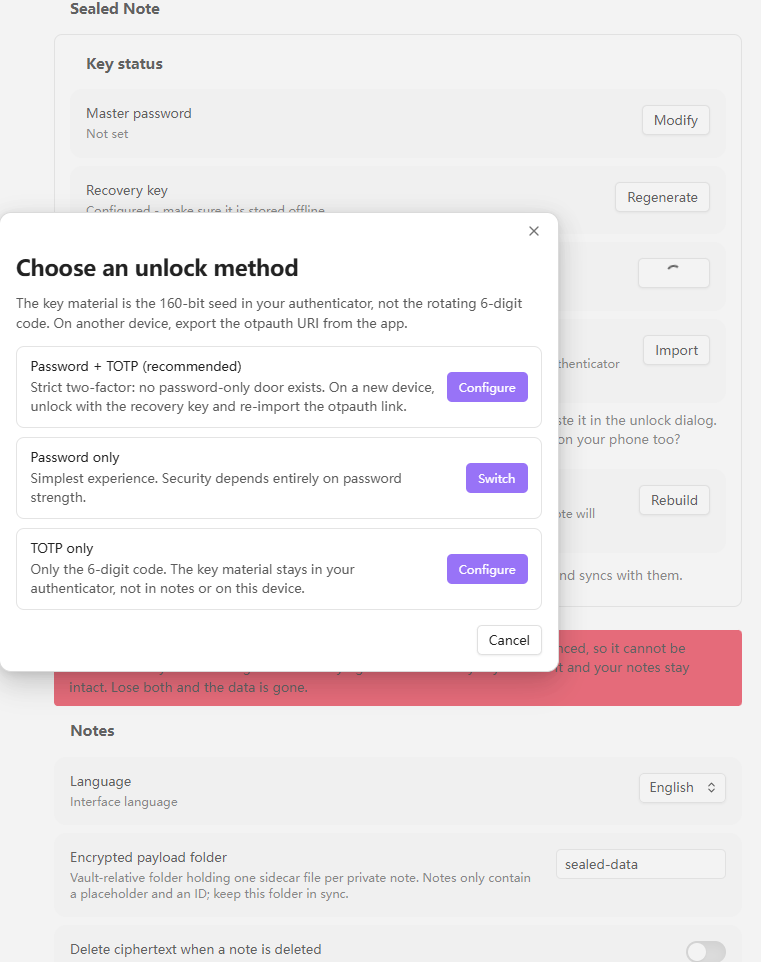
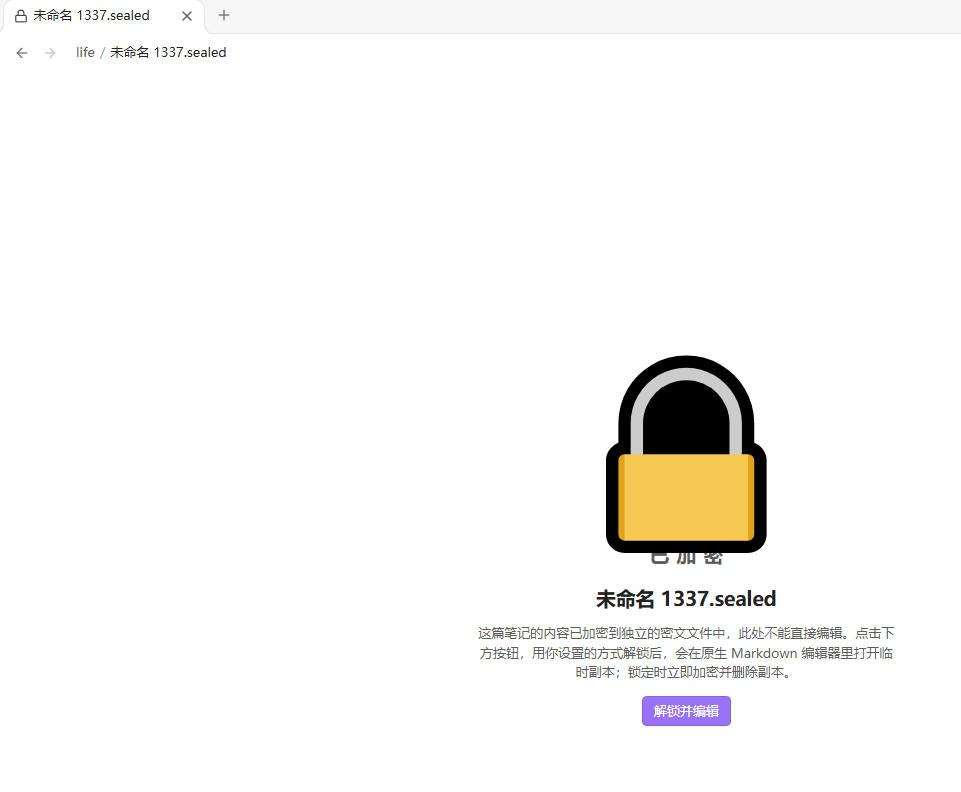

# Sealed Note

[English](README.md) | **简体中文**

Obsidian 隐私笔记插件：**只加密你指定的笔记和片段**，不加密整个保管库。忘记密码不会导致数据永久丢失。

## 界面截图



*设置页与解锁方式选择弹窗。*



*隐私笔记的锁定态：正文被大锁覆盖，点「解锁并编辑」才弹解锁窗。*

---

## 要点

1. **密码无法被找回，但可以重置。** 任何声称能找回密码的加密产品，要么在骗你，要么留了后门。这里用恢复密钥重设密码，笔记一字不动。
2. **没有密钥库文件，也没有独立的密文目录。** 密钥藏在每篇锁定笔记自己的正文信封里，随同步走。任意一篇能解开整个库；不需要维护 `sealed-data/`，也不需要注释锚点。
3. **用原生 Markdown 编辑器写加密笔记。** 解锁后正文变成**纯明文**（无任何注释），源码模式、实时预览、沉浸式模式等全部可用；按「加锁时机」策略（默认失焦即锁，可放宽）自动把同一文件加密回信封——磁盘上永远只有这一个文件。
4. **一个文件就是全部。** 锁定态 `xxx.sealed.md` 的正文就是密文信封；解锁态正文是明文。改名、移动、同步都不会让密文和笔记分家。

> 📖 加密原理、术语表、架构图见 **[docs/CRYPTO.md](docs/CRYPTO.md)**  
> 📖 扫码和动态密码的原理见 **[docs/TOTP-PRINCIPLE.md](docs/TOTP-PRINCIPLE.md)**

---

## 完整架构总览

```
┌──────────────────────────────── 人类凭据层 ────────────────────────────────┐
│                                                                          │
│   主密码(脑子里)      恢复密钥(纸上)      TOTP种子(手机验证器)             │
│        │                  │                      │                       │
│        │ 你设置的          │ randomBytes(20)      │ randomBytes(20)       │
│        │ 不生成不保存      │ 52 字符              │ 32 字符，扫码给手机    │
└────────┼──────────────────┼──────────────────────┼───────────────────────┘
         │                  │                      │
         │ credentialFor() 加域前缀（sn-pwd| / sn-rec| / sn-totp|）
         ▼                  ▼                      ▼
   PBKDF2-HMAC-SHA512 × 600,000 + 每槽独立盐
         │                  │                      │
         ▼                  ▼                      ▼
┌────────────────── 信封层（在每篇锁定笔记自己的正文里）──────────────────────┐
│                                                                          │
│   slot.password     slot.recovery      slot.totp    slot.password-totp   │
│   ┌──────────┐      ┌──────────┐      ┌────────┐    ┌──────────┐       │
│   │KEK→DEK盒 │      │KEK→DEK盒 │      │KEK→盒  │    │KEK→DEK盒 │       │
│   └──────────┘      └──────────┘      └────────┘    └──────────┘       │
│                                                                          │
│   任一个盒子解开 → 同一把 DEK（32 字节，永不裸存、换凭据不变）              │
│   AAD = sealed-note|keyring|vaultId|slot|gen  → 防跨库/跨槽/旧代篡改       │
└──────────────────────────────┬───────────────────────────────────────────┘
                               │ HKDF-SHA256（域隔离：整篇 / 行内 / 块）
                               ▼
┌────────────────────────── 加密对象层 ────────────────────────────────────┐
│                                                                          │
│  ① 隐私笔记 xxx.sealed.md 锁定态正文 = 密文信封（解锁后变纯明文）          │
│  ② 普通笔记里的 ```encrypted_txt``` 块    sn1.<base64>                    │
│  ③ 行内密文 `sn1.xxx`                     Ctrl+点击 → 直接进剪贴板         │
│                                                                          │
│  三者共用同一把 DEK 的不同 HKDF 子密钥，每篇/每处独立盐与 IV              │
└──────────────────────────────┬───────────────────────────────────────────┘
                               │
         ┌─────────────────────┼─────────────────────┐
         ▼                     ▼                     ▼
┌─────────────────┐  ┌──────────────────┐  ┌────────────────────┐
│ 磁盘 vault      │  │ 本机存储(不同步)  │  │ 同步到云端          │
│ .sealed.md 单文件│  │ 设备密钥(加密种子)│  │ Remotely Save/Git/ │
│ = 密文/明文正文  │  │                  │  │ 只需同步这一个文件 │
│ backups/ 历史   │  │ seedRef(种子密文) │  │ Obsidian Sync      │
│                 │  │ 会话内存种子      │  │ → 只有密文+密盒    │
└─────────────────┘  └──────────────────┘  └────────────────────┘
         │                     │                     │
         └─────────────────────┼─────────────────────┘
                               ▼
                  tools/decrypt.html（离线应急，单文件不联网）
                  粘贴任意一篇 .sealed.md + 密码/恢复密钥 → 出明文
```

**一句话读图**：三种凭据各自包住同一把 DEK（信封层）→ DEK 派生子密钥加密三种对象（加密对象层）→ 密文和密钥盒子一起存进笔记正文随同步走；本机只多存一份"加密种子的钥匙"用于免重扫。

---

## 为什么是"重置"而不是"找回"

加密产品的核心承诺是"连开发者本人也打不开你的笔记"。而"能帮你找回密码"要求有人知道你的密码。**这两句话不能同时为真。**

所以任何声称能找回密码的本地加密产品，只可能是：密码被存下来了（等于没加密）、用了更弱的密保问题（等于泄露信息）、或有人替你保管密钥（端到端加密失效）。

准确的说法是：**你丢的不是密码，是"包装钥匙的盒子"；钥匙本身（数据密钥）还在。**

```
主密码   ──PBKDF2──▶ 解开 ┐
                          ├──▶ 数据密钥（真正的钥匙）──▶ 所有笔记
恢复密钥 ──PBKDF2──▶ 解开 ┘
```

- 改密码 = 重新包装一次数据密钥。**笔记内容不重新加密**，一个字节不动。
- 忘记密码 = 用恢复密钥取出同一把数据密钥，重设密码。
- 只有恢复密钥也泄露时，才需要轮换数据密钥 + 全库重加密（高级操作）。

### 丢了凭据怎么找回

先记住一句：**你丢的从来不是"钥匙"（数据密钥），而是"包装钥匙的盒子"（某个凭据）。** 只要还剩下**任意一个**能用的凭据，内容就一个字节不会丢。下表按"你手上还剩什么"给动作：

| 你丢了 | 手上还有 | 找回动作 | 笔记内容 |
| --- | --- | --- | --- |
| **主密码** | 恢复密钥 | 解锁任意一篇时切到「恢复密钥」标签进入 → 设置 → 修改密码（把密码重设成新的） | 一字不动，不重新加密 |
| **动态密码**（换设备后本机种子没了） | 手机验证器还在（能导出 otpauth 链接） | 什么都不用输：设置 →「恢复本机种子缓存」粘贴 otpauth 链接即可——恢复的是**同一把种子**，之后只输 6 位码（纯动态模式会当场验证链接正确才接受） | 一字不动 |
| **动态密码**（手机也丢了，种子的唯一副本没了） | 主密码 或 恢复密钥 | 用密码/恢复密钥进入 → 设置里重新绑定动态密码（生成新种子、重扫一次）。注意：重绑后旧手机上的验证码不再有效 | 一字不动 |
| **恢复密钥**（不知道放哪） | 主密码 或 动态密码 | 正常解锁 → 设置 / 命令面板「查看/重新生成恢复密钥」生成新的一份并打印留存（旧那份随即作废，以新为准）。注意：命令弹窗里**只显示新生成的**，旧密钥不会显示出来——趁密码还在时尽早补一份 | 一字不动 |
| **全部能用的凭据**（如纯密码模式忘了密码且恢复密钥也没了；或组合模式密码+手机+恢复密钥同时丢） | 无 | 无法找回。这正是"连开发者也打不开"的另一面 | ❌ 永久无法解密 |

> ⚠️ 唯一真正会丢内容的是**最后一行**：所有凭据同时失效。所以恢复密钥务必离线留存一份，且**不要和笔记放同一个同步盘**。

---

## 密钥在哪里：没有 keyring 文件

**插件目录里没有任何密钥文件。** 没有 `keyring.json`，也不需要配置同步工具去同步什么隐藏目录。

每篇锁定笔记的正文信封里都带一份 `keys` 字段，装着被包裹起来的数据密钥。因为所有笔记用同一把数据密钥的 HKDF 子密钥加密：

> **任意一篇带密钥的笔记，能解开整个保管库**——不只是它自己。

| 情况                  | 结果                  |
| ------------------- | ------------------- |
| 换设备 / 重装插件          | ✅ 笔记同步过来，密钥就在       |
| 同步工具排除了 `.obsidian` | ✅ 完全无影响——密钥不在那里     |
| 丢了一篇笔记              | ✅ 只丢那篇内容，其他笔记仍有密钥   |
| 所有笔记都丢了             | ❌ 内容没了（密钥救不了不存在的内容） |

**你唯一需要离线保管的是恢复密钥**（52 字符，初始化时生成一次）。它忘了密码时能重设；它配合任何一篇笔记就能恢复一切。

---

## 安装

```bash
npm install
npm run build
npm run deploy -- "D:/work/obsidian"
```

重启 Obsidian，在 **设置 → 第三方插件** 中确认 Sealed Note 已启用。

### 首次使用

1. 左侧栏 🔒 图标，或命令面板搜索"新建隐私笔记"
2. **选择解锁方式**：纯主密码 / 纯动态密码 / 密码 + 动态密码（三者都可独立使用，随时可改）
3. 按选择设置主密码和/或扫描动态密码二维码
4. **保存恢复密钥**：复制、下载或打印，勾选确认
5. 创建第一篇笔记时，密钥随它一起写入

**纯动态密码从第一天就能用**，不需要先设主密码。恢复密钥始终生成，作为最后兜底。

**新笔记建在哪**：和 Obsidian 原生"新建笔记"一样——当前聚焦文件所在的目录；没有聚焦文件就建在保管库根目录。没有额外的文件夹配置项。

**界面语言**：设置里有「界面语言」，可选跟随 Obsidian、English、简体中文。默认跟随 Obsidian。

---

## 用法

### 隐私笔记（整篇加密）

1. 新建时先**起个名字**（如「日报」「总结」）——插件会自动加上 `.sealed.md` 后缀，你不用管后缀。**创建前就要验证一次**：内存里已有密钥（刚解锁过别的笔记）就直接建；没有就弹一次「加密」窗，输对后光标进入干净的空白编辑器。**取消则不创建任何文件**。磁盘上只有 `名字.sealed.md` 这一个文件，创建瞬间正文就是真密钥封的密文。
   - **改名/移动都安全**：密文就在文件内部，不存在"正文和密文分家"的可能。万一改名时不小心把 `.sealed.md` 后缀删了，插件会**自动补回**。
2. 切走后再点回隐私笔记：**只显示一个大 🔒 的加密页面，不会自动弹窗**；点页面上的「解锁并编辑」按钮，才弹解锁窗（主密码 / 动态密码 / 主密码+动态密码），输对后进入原生编辑器。
3. 解锁后正文变成**纯明文**——没有 ID 注释、没有任何要维护的东西。源码模式、实时预览、沉浸式模式、补全和编辑命令全部可用，Obsidian 自己的自动保存负责正文。
4. **锁定的时机由「加锁时机」策略决定**（见下表）。任何一次锁定都是同一套动作：把最新内容加密、把同一文件的正文换成信封、从内存清除密钥；回来重新看到大 🔒。
5. **打开笔记只看正文内容决定是否显示大锁**：正文是密文信封就显示 🔒，是明文就直接编辑。不弹窗、不抢占任何面板。
7. 普通笔记里的内嵌加密块（隐私语法块）不受上述大 🔒 影响——不解密也能正常编辑整篇文档。手输的明文块在离开时自动封存成密文，已封存的块点一下才单独解密；两者共享上面同一套「加锁时机」策略。

### 加锁时机（三级策略，默认最严）

设置 → Sealed Note → **加锁时机**。三级是一条从严到宽的阶梯，任何一级都仍然生效「锁定全部」手动入口（状态栏点击 / 命令面板 / 右键 / 丝带菜单）：

| 级别 | 切窗口（如切到浏览器/WorkBuddy） | 切到别的笔记 / 标签页 / 设置页 | **关掉这篇笔记的标签页** | 关闭 Obsidian |
| --- | --- | --- | --- | --- |
| **失焦即锁定**（默认，最安全） | 🔒 立即锁定 | 🔒 立即锁定 | 🔒 锁定 | 🔒 锁定 |
| **关闭笔记才锁定** | 不锁 | 不锁（明文留在笔记里，切回来免密码接着写） | 🔒 锁定 | 🔒 锁定 |
| **本次 Obsidian 只解锁一次** | 不锁 | 不锁 | 不锁 | 🔒 锁定 |

- 「切窗口」指 Obsidian 整个应用失去焦点（Alt+Tab、切到别的应用）。
- 「切走不锁」的代价要清楚：中间级别下，没关标签的笔记会以明文留在 `.sealed.md` 本体里（可被索引/同步），直到你关掉那个标签页、手动锁定或退出 Obsidian。

> 🔒 **单文件，无独立密文目录、无需维护注释。** 锁定态 `.sealed.md` 的正文就是密文信封（HTML 注释包裹的 JSON，阅读视图下不可见）；解锁时换成**裸明文**，锁定时换回信封。没有 `sealed-data/`、没有 `.sealedpayload`、没有 `sealed-note:ref` 注释，也就没有"千万别删某段注释"的心理负担。
>
> ⚠️ **唯一窗口**：解锁编辑期间，明文就存在 `.sealed.md` 本体里，会被 Obsidian 索引、被同步工具同步。这是应用层原位编辑的诚实边界。请只在需要编辑时才解锁，编辑完按「加锁时机」自动锁定（默认切走/失焦即锁）。异常退出留下的明文正文**不会被启动时偷偷清空**，下次锁定会用真密钥封好，一个字不丢。
>
> 同步 `xxx.sealed.md` 就像同步任何一篇笔记——**一个文件就是整篇笔记**，没有第二个要记得同步的东西。

**删除与密文**：删除笔记即删除密文（同一个文件）。恢复走普通文件恢复路径（版本历史 / 回收站），和其他笔记完全一样。

### 内嵌加密块

在普通笔记里直接写明文即可：

````markdown
```encrypted_txt
我的秘密内容
```
````

- **离开时自动封存**：切笔记/标签、窗口失焦、打开设置、切到阅读视图、关闭标签——与隐私笔记的加锁时机完全一致。本次会话已解锁过就静默加密成 `sn1.…` 密文（原地改写这个块）；钥匙不在内存时才弹一次密码。
- **取消不删内容**：块原样保持明文，状态栏持续显示 `⚠` 警告，下次回来再问。Obsidian 没有"拦住视图切换"的 API，留痕提醒是诚实的实现。
- **阅读视图**显示 `🔓 尚未加密` 和"立即加密此块"按钮——点它可随时封存。已封存的块显示 `🔒 已加密`，点击解密（只在屏幕上，不改文件）。
- 别名：`txt_encrypted`、`sealed`。也可以选中文字 → 右键 → 加密所选内容，立即加密、不必等离开时机。

### 行内密文

选中文字 → 右键 → 加密所选内容 → 变成 `` `sn1.xxx` ``，阅读态显示为 `🔒 密文`。  
按住 `Ctrl` 点击：直接复制到剪贴板，**不显示在屏幕上**。

### 右键菜单

| 场景        | 菜单项                                  |
| --------- | ------------------------------------- |
| 源码模式编辑器（任何笔记） | 解密文档 / 加密所选 / 解密所选 / 解密所选到剪贴板 |
| 文件树 → **目录**   | 新建隐私笔记（在该目录内创建，和 Obsidian 原生「新建笔记」一致） |
| 文件树（隐私笔记或明文笔记） | 解密文档（隐私笔记生成明文副本；明文笔记就地解密所有密文块） |
| 文件树（隐私笔记）    | 解锁 / 锁定     |
| 阅读态密文块/密文药丸  | 点击 → 按配置方式弹解锁窗 → 显示原文            |

---

## 解锁方式

三种模式任选（初始化时选，之后随时可改），恢复密钥是兜底通道、始终并列在弹窗里。弹窗只列出**当前模式实际存在的通道**——模式选什么，解锁就要什么，没有多余的"默认方式"设置：

| 方式 | 你要输入 | 换设备 / 重启后 | 备注 |
| --- | --- | --- | --- |
| **纯主密码** | 你设置的密码（不存盘，只参与派生） | 直接可用 | 最简单 |
| **纯动态密码** | 手机验证器的 6 位码 | 手机验证器带着即可；本机**不用重新扫码**——种子用设备密钥加密存在本机，重启后自动恢复 | 新电脑：先用恢复密钥进入 → 设置「恢复本机种子缓存」粘贴 otpauth 链接 |
| **密码 + 动态密码** | 主密码 + 6 位码（缺一不可） | 严格双因子：组合模式下**不存在**单独的「主密码」通道，弹窗里没有可绕过的密码标签。本机重启后种子自动恢复，直接输两个即可 | 新设备：用恢复密钥进入 → 设置「恢复本机种子缓存」粘贴 otpauth 链接恢复种子 |
| **恢复密钥** | 52 字符（自动补 `-`，忽略大小写/空格） | 始终可用 | 离线保管的最后一道门；忘了放哪，趁密码还在时到设置「查看/重新生成恢复密钥」补一份 |

**输错有限流，不会越试越久**：前 5 次自由尝试；从第 6 次起按 1s → 2s → 4s → … 指数退避，单次最长 60 秒；**任何一次成功立即清零**。空提交（没填就点确认）不算尝试、不消耗次数。计数记在密钥副本里，换设备也一样。

> **关于「密码 + 动态密码」的诚实说明**：组合模式是**严格双因子**——初始化时不再创建独立的密码槽，弹窗里也没有可单独进入的「主密码」标签，只有密码 + 动态码（或恢复密钥）两条路。早期版本创建的旧库仍留有那个单密码通道：设置页会显示「严格双因子」一栏，点「收口：删除单密码通道」即可补齐（会顺带刷新所有笔记里的密钥副本，无需重新扫码）。

设置动态密码时，插件**本地**生成二维码（绝不联网），用 Authy / Google Authenticator / 1Password 扫码即可接入。

**密钥材料是验证器里的 160 位种子，不是每 30 秒变化的 6 位码**。6 位码只用来证明你持有验证器；明文种子不写盘、不进笔记、不上传。种子用设备密钥加密后存在本机（不同步），所以**同一台设备重启后只输 6 位码即可，不用重新扫码**。只有换新设备时才需要粘贴一次 otpauth 链接。多台手机扫同一个二维码会得到相同种子，因此显示的 6 位码也相同。

> 📖 详见 **[docs/TOTP-PRINCIPLE.md 第 11 节](docs/TOTP-PRINCIPLE.md#11-种子在插件的哪里多设备一致吗)**

### 解锁失败时怎么提示

提示按**实际原因**分开，不会把所有错误糊成一句"密码不正确"：

| 你看到 | 实际原因 | 下一步 |
| --- | --- | --- |
| 动态密码不对 | 码本身错了（每 30 秒换一次，且有 ±1 步容差） | 等新码再填；若每次都错，说明本机种子和验证器不是同一把，切到「恢复密钥」解锁后到设置重新绑定 |
| 动态密码是对的，但和保管库密钥对不上 | 种子不是绑定时那一把，或换过主密码 | 用恢复密钥解锁一次，再回设置重新绑定动态密码 |
| 动态密码对，但主密码和它对不上 | 组合模式下密码或种子有一个不对 | 组合模式没有单独的密码标签可试；确认两者都用对，仍不行就用恢复密钥重设两者 |
| 主密码不对 | 密码错了 | 用恢复密钥解锁后到设置重设主密码 |
| 恢复密钥不对 | 抄错，或不是这个库的密钥 | 照抄那串分组字符即可（空格和连字符不影响）；备份不在手边只能用主密码或已解锁的设备 |
| 请输入 6 位动态密码 | 输入框空着 | 填上即可，**不会消耗尝试次数**（空提交不触发锁定） |
| 这台设备上没有可用的动态密码种子 | 换了电脑，或本机应用数据被清理 | 用恢复密钥解锁 → 设置 → 「恢复本机种子缓存」粘贴 otpauth 链接，恢复的是**同一个种子**、手机不用动；解锁弹窗此时**保持打开**，可原地照做 |

另有三类提示不要混淆：**弹窗里**是"进不去密钥环"；**右上角**"无法解密这篇笔记…"是进了密钥环但这篇的密文打不开，提示从备份/文件历史恢复；**右上角**直接报错原文是保存写盘失败（该路径已修复，正常不应再出现）。

---

## 改密码时会发生什么

**不重新加密笔记内容。** 数据是 AES-256-GCM 密文，数据密钥没变，`data` 字段一个字节不动。

```
批量更新每篇加密笔记的 keys 字段
  → 只改这几行 JSON，data/salt/iv 原样拷贝
  → PBKDF2 只跑一次
  → 只识别加密笔记，普通 Markdown 一个都不碰
  → 可中断续跑，已更新的自动跳过
```

---

## 离线解密工具

`tools/decrypt.html` 是单文件、无依赖、不联网的应急工具。**插件运行时不使用它。**

1. 浏览器打开（双击即可）
2. 粘贴一篇 `.sealed.md` 笔记全文
3. 输入主密码**或**恢复密钥

密钥就在笔记自己里面，通常不需要额外文件。用途：验证备份是否还能打开、在没装 Obsidian 的机器上解密。

有专门的兼容性测试把真正的 HTML 抽出来跑，确保它解出的结果和插件一致。

**安全提醒**：只使用你自己仓库里的这个文件。别人发给你的版本可能被改过。

---

## 安全边界

### 能防

- 云同步泄漏（坚果云/iCloud/Git 只看到密文）
- 电脑被翻，但 Obsidian 已锁定
- 拿到 vault + 知道密码，但没有你的手机（若开了动态密码：组合或纯动态模式都是严格通道，单独密码进不去）
- 离线爆破被 600,000 次 PBKDF2 拖慢

### 防不住（重要）

- **解锁状态下**：明文在内存和渲染层，可被截屏、录屏、剪贴板、恶意插件读取
- **文件名、大小、数量、修改时间**
- **键盘记录器**、被入侵的操作系统
- **弱密码 + 拿到笔记** → 离线爆破（有强度提示，但不强制）
- **恢复密钥拍照存相册** = 把钥匙贴在门上

### 关于文件名与索引

`.sealed.md` 的文件名是明文，会进 Obsidian 索引。锁定态正文是密文信封（HTML 注释包裹，阅读视图下不可见），解锁态正文是明文。敏感场景请用中性文件名。

### 文件损坏时的恢复

没有注释、也没有独立密文文件可丢——**密文就是笔记本身**。恢复走普通文件恢复路径：

1. **版本管理（最佳）**：Git / 带历史版本的同步工具，直接把 `.sealed.md` 恢复到好的版本——无损、自动。
2. **恢复密钥**：信封里的 key copy 完好但忘记凭据时，走正常解锁流程用恢复密钥。若外部编辑器把信封改成了文本，下次解锁时会把那段文本加密保存，旧字节先备份。
3. 文件本身丢了，只能从文件历史找回——和其他任何笔记一样。

---

## 备份建议

1. **恢复密钥** → 打印，放实体安全处，不要和 vault 放同一个同步盘
2. **保管库本身** → 你现有的同步/备份方案（笔记自带密钥，同步即备份）
3. 插件 `backups/` 目录保留最近 5 份密文历史

**卸载前**：先解密所有笔记。卸载后 `.sealed.md` 没有插件打不开，可用 `tools/decrypt.html` 救。

---

## 兼容性

Obsidian 1.5.0+，桌面端与移动端（只依赖 Web Crypto，无 Node API）。  
与 Obsidian Sync、Remotely Save、Git 等同步方案兼容。

## 许可

MIT
